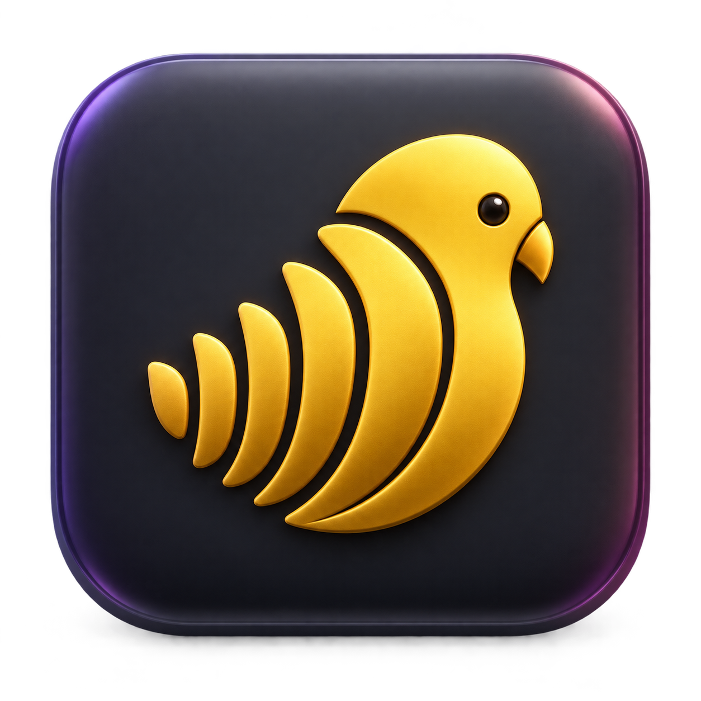
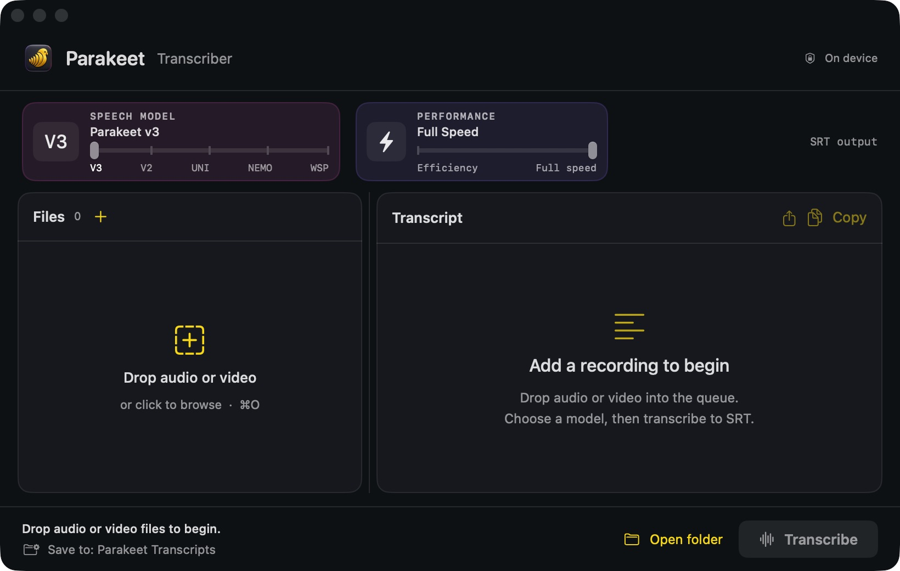
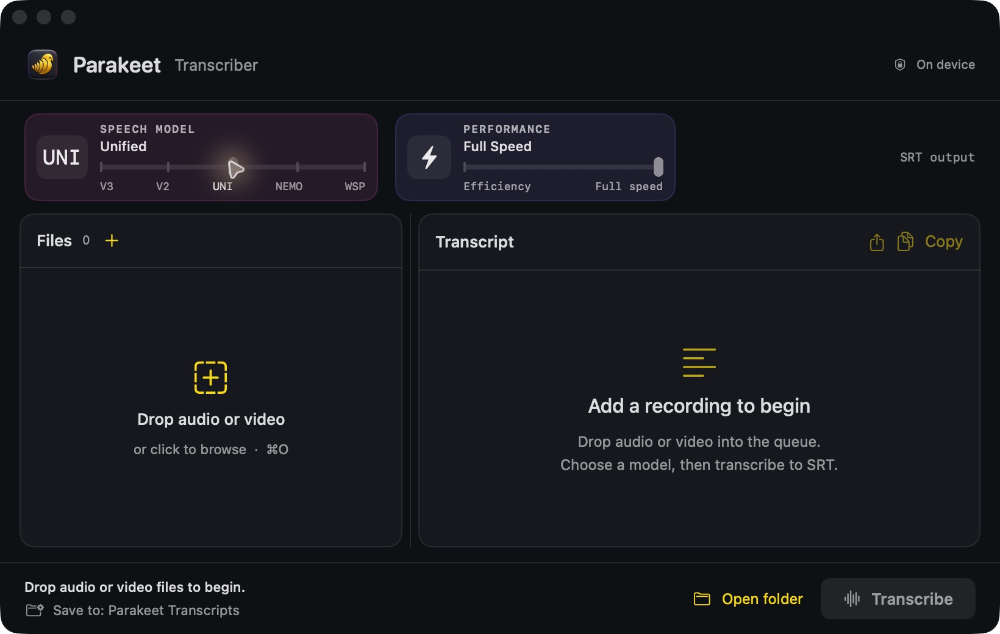

# Parakeet Transcriber

<p align="center">
  
</p>

[View the software showcase](https://nolan-mac-apps.nolankrahn.chatgpt.site/apps/parakeet)

The compact workspace keeps model and performance sliders, the new app icon, and an animated processing waveform. Larger slider labels, restrained colour accents, and distinct **Save to** / **Open folder** actions make the controls easier to read and identify.

A compact native macOS front end for fully local transcription with MacParakeet. It supports multiple Parakeet, Nemotron, and Whisper models, live progress, batch input, copy-to-clipboard, and Sparkle updates.

The refreshed workspace opens at 820×520 and fits down to 720×460. Compact glass model/performance tiles use native sliders above a resizable file queue and selectable transcript preview. Speech models snap to five supported engines; performance snaps between Efficiency and Full Speed. A lightweight waveform animates during processing, pauses when the app is inactive, and respects Reduce Motion. The app has a custom sculpted parakeet icon.

## Quick install

```sh
brew install --cask italian-seasoning/tap/parakeet-transcriber
```

Homebrew also installs [MacParakeet CLI](https://github.com/moona3k/homebrew-tap), the on-device transcription engine.

Current preview: **1.2**. [Download the ZIP](https://github.com/Italian-seasoning/ParakeetTranscriber/releases/download/v1.2/Parakeet-Transcriber-1.2.zip).

Requires macOS 13 or newer on Apple silicon.

These previews are not Apple-notarized. Homebrew verifies the archive checksum and leaves Gatekeeper enabled. If macOS blocks the first launch, review the app in **System Settings → Privacy & Security**. Sparkle verifies subsequent in-app updates with its signed feed.

## See the app





Screenshots show local preview builds. Empty queues and standby states are shown where applicable.


## Mac integration

- **Finder Open With:** open supported media in Parakeet to add it to the queue. Parakeet registers as an alternate viewer; it does not replace your default media player.
- **Finder Services:** select files and choose **Services → Queue in Parakeet**. Enable the service under macOS Keyboard Shortcuts → Services if it is hidden. This queues files for review before transcription.
- **Clipboard files:** copy files in Finder, then press **⇧⌘V** or choose **Add clipboard files** from the queue's plus menu.
- **Finder output:** after a run, **Show output** selects the actual generated SRT files in Finder, including filenames renamed by the CLI to avoid collisions.
- **Share sheet:** use the transcript's share button to hand generated subtitles to another app through macOS.

Supported inputs: AVI, FLAC, M4A, MKV, MOV, MP3, MP4, OGG, OPUS, WAV, and WEBM. Queue and destination changes are disabled while a transcription is running.

## Requirements

- macOS 13 or newer on Apple silicon
- `macparakeet-cli` installed at `/opt/homebrew/bin/macparakeet-cli` or `/usr/local/bin/macparakeet-cli`
- Xcode command-line tools for source builds

## Build

```sh
./script/build_and_run.sh
```

The app and transcription models stay local. Sparkle checks the public `appcast.xml` in this repository for signed updates.

## Install with Homebrew

```sh
brew install --cask italian-seasoning/tap/parakeet-transcriber
```

The current public build is ad-hoc signed and not Apple-notarized. The cask verifies the pinned SHA-256 and leaves macOS Gatekeeper checks enabled. Sparkle verifies future updates with its EdDSA signature.

## Release status

`script/package_release.sh` uses Developer ID signing and notarization by default. `script/package_release.sh --adhoc` creates the explicitly unnotarized build used by the current Homebrew cask.

## License and attribution

[MIT](LICENSE) — Copyright © 2026 [Italian-seasoning](https://github.com/Italian-seasoning). Forks and redistribution are allowed; retain the copyright and license notice. Please identify independently maintained forks and link back to this project. Third-party components retain their own licenses.
